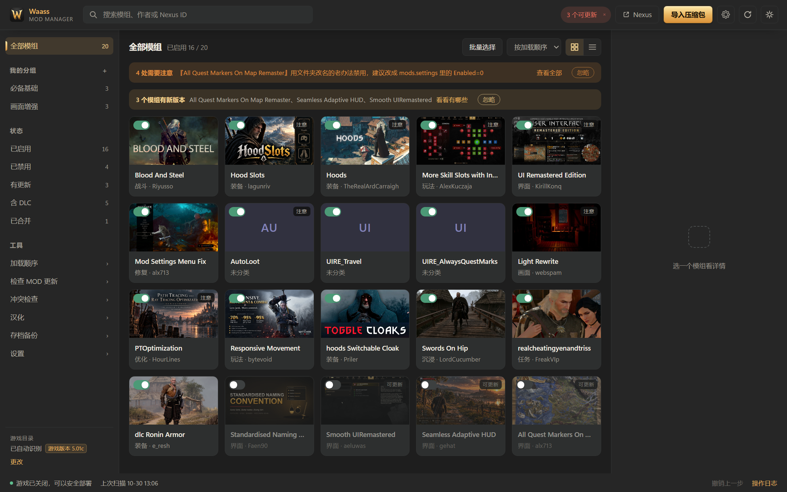
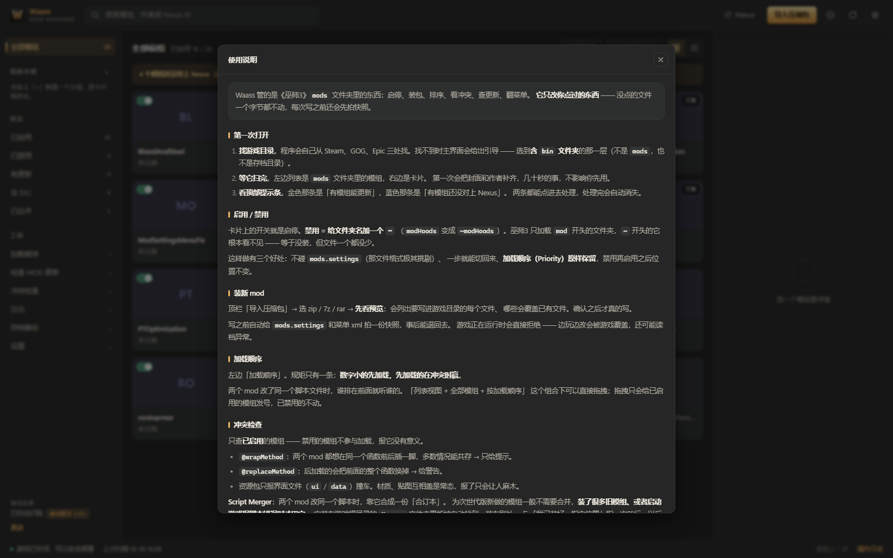

# Waass Mod Manager

A lightweight mod manager for The Witcher 3: Wild Hunt (next-gen). Standard library only, touches only what it must, and every step can be undone.



> **Recent update (1.2.9)**: upgrading is now just "swap the exe". A new build backs
> up your existing data in full before migrating it, renames unreadable files instead
> of deleting them, and runs a self-check on every launch — program updates and data
> problems are reported right in the top banner (red ones can't be dismissed).
> Previous release (1.2.8): the interface speaks English, one-click toggle, roughly
> 960 strings bilingual, native English docs. Earlier (1.2.7): fixed the background
> process that survived a closed window.
> Full history: [CHANGELOG.md](CHANGELOG.md) (Chinese) · [CHANGELOG.en.md](CHANGELOG.en.md).

## System requirements

| | |
| --- | --- |
| OS | **Windows 10 / 11 (64-bit)** |
| Game | The Witcher 3: Wild Hunt next-gen **v5.x** (Steam / GOG / Epic all work) |
| UI | The bundled Microsoft Edge, or an installed Google Chrome |

The Witcher 3 has no Linux / macOS version, so this tool is Windows-only — on other systems it fails at the import stage with an error instead of showing a half-broken UI.

**Zero third-party runtime dependencies**: ~20k lines of Python, all standard library; the UI is plain HTML/CSS/JS. It packages into a single 9 MB exe.

## Installation

### Option 1: download the exe (recommended)

1. Grab `Waass-x.y.z.exe` from [Releases](../../releases)
2. Double-click to run — no installation needed
3. If Windows warns about an "unknown publisher", that is normal for an unsigned exe: click "More info → Run anyway"

The release notes include a SHA256 checksum you can verify after downloading.

Data lives in a `data/` folder next to the exe (copy it along and everything moves with it). If the exe sits in a non-writable location such as `Program Files`, it automatically falls back to `%LOCALAPPDATA%\WaassModManager`.

### Option 2: run from source

```
git clone <repo url>
cd waass
python run.py
```

Requires Python 3.10 or newer, **no third-party dependencies**, no `pip install`.
You can also double-click `Waass.bat` (it looks for `pythonw` / `python` on PATH).

```
python run.py              normal start (uses the built-in window if pywebview is available, otherwise opens an Edge/Chrome app window)
python run.py --browser    open in the default browser instead
python run.py --serve-only start the server only, for debugging
python run.py --port 8765  use a specific port
```

## Upgrading

**A new version means one thing: overwrite the old exe and double-click it.**
Your `data/` folder stays exactly as it is — mod list, groups, Nexus IDs, install
records, localization originals and save game backups all live there, and the new
build picks them up as they are. No export, no import, no manual file shuffling.

Every launch starts with a self-check:

- **Did the version just change?** The app answers the question that actually matters:
  "existing data checked out (N files read fine)", or exactly which items failed to
  read and what they're called.
- **When the data format needs upgrading**, a complete copy is made to
  `data/_backup/pre-schema…/` <i>before</i> anything is touched. To roll back, copy
  those files into `data/` again.
- **A damaged data file** (power loss, hand-edited JSON with a missing brace) is renamed
  to `xxx.json.broken-<timestamp>` and **kept, never deleted**. The app carries on as if
  that record were missing and rebuilds it.
- **Going back to an older build**: if the data was written by a newer version, the app
  switches to **read-only** — everything stays browsable, but not a single byte is
  written, so an older build can't force its idea of the schema onto newer data.

The result shows up in the top banner (green / amber / red). Green and amber can be
dismissed with "Got it"; **red cannot** — it means your data needs attention and you
need to know why. Settings → About shows "Data format: vX (program supports vY)" and
offers a "Run check" button.

## First launch

The program locates your game folder on its own: it reads the Steam library index (multiple libraries on multiple drives are handled), the GOG registry, and Epic's install manifests. Only if all three fail does it fall back to a few common default locations.

If it still can't find the game, the main area explains which level to pick — **select the folder that contains both `bin` and `witcher3.exe`, not the inside of `bin`**. You can also hit "Search again" to rescan (useful right after installing the game or plugging in a new drive).

## Built-in guide

The program ships with one: **Settings → Guide**. Ten sections, from first launch through upgrading, your data and troubleshooting. It explains the reasoning, not just button positions (why disabling renames a folder, which `Priority` number wins, why an uncertain Nexus ID is left blank rather than guessed).



The content lives in `web/static/guide.html` and follows the theme — edit that file to change the text, no need to rebuild the UI.

---

## What it can do

| Capability | Status |
| --- | --- |
| Scan and identify mods, DLCs, menu files, language files | Available |
| One-time import of Nexus IDs / authors / categories / covers from an older manager into its own records | Available |
| One-click enable / disable (**disable = add `~` to the folder name**, never writes `mods.settings`) | Available |
| Drag-and-drop load order in the list view | Available |
| **Disabled mods sort last**: display only — re-enabling puts them back where they were (real priority untouched) | Available |
| Automatic snapshot before every write, undo from the status bar | Available |
| Import and install from zip / 7z / rar / tar-based archives, with a preview of every path it will write | Available |
| Uninstall goes to quarantine; one click restores, equivalent to a reinstall | Available |
| High-risk package interception: anything writing DLLs into `bin/` requires explicit confirmation | Available |
| Packages that modify the game's own config files are flagged separately before install | Available |
| **Game config files are merged line by line**: only the mod's lines are added, uninstall removes exactly those lines | Available |
| Save game backups (full / incremental) and restore | Available |
| **Watched download folder**: packages downloaded in the browser show up automatically under "Import" | Available |
| Conflict checks: same-name scripts, duplicate menu entries, duplicate priorities, malformed structure | Available |
| **Collisions inside resource bundles**: two mods shipping the same UI file in their `.bundle`s | Available |
| **Annotation collisions**: two mods hooking the same function (order-sensitive) | Available |
| **Legacy package health checks**: scripts not saved as UTF-8, language file version older than the game | Available |
| **Batch selection**: toggle multiple mods at once, undo restores everything in one step | Available |
| **Reads Script Merger's inventory**: merged groups are marked green instead of reported as conflicts, and it can launch Script Merger for you | Available |
| **Script Merger onboarding**: download link if missing, "point to the exe" if installed elsewhere | Available |
| **Load order panel**: drag one row, change one priority, all written in one pass | Available |
| **Check for mod updates** (ID / page / version tracking + automatic metadata fetch) | Available |
| Custom groups + tags (drag cards into groups, `#tag` search) | Available |
| Built-in menu text translation for mods (see below) | Available |
| **Storage & cleanup**: see what each category occupies, clear only what regenerates | Available |
| One-click clean restore (uninstall everything back to stock) | Available |

### "Check for mod updates": no API key, and no guessing

**No key required, no official API.** It uses the same public query endpoint that Nexus' new web frontend calls (`api-router.nexusmods.com/graphql`) — read-only, public data only, no login. The website itself sits behind a Cloudflare challenge the program can't pass; that endpoint doesn't, so it can be queried directly.

**How each mod's identity is determined**, in order (first match wins):

1. **What you confirmed.** A manually entered ID, or a candidate you clicked — always yours, never overwritten.
2. **What it remembered.** `data/nexus_ids.json` — identified once, saved for good; clearing the download folder doesn't lose it.
3. **This program's install records.** If it installed the package, the ID in the archive name is already recorded.
4. **The original archive name in your download folder.** Three naming schemes are recognized: new format
   `Light_Rewrite_12144_0.26.2_2026-10-23T03-19Z_864tMl89U.zip`,
   space-separated `Hoods 4242 3.7 2026-10-16T13-25Z M3vl4EMry.zip`,
   legacy `Hoods-4242-3-7-1698765432.zip` (variable version segments, parsed right to left).
5. **A nexusmods link in the mod's own README.**
6. **If all else fails, it asks you.** At startup, candidates are fetched in the background (local download folder + Nexus search, merged) and listed as "possibly this one" under "missing IDs". One click binds it — but the program never decides for you.

**Why the last step isn't automatic**: Nexus has too many same-named mods by different authors (`AutoLoot` has three implementations by three authors; the one you actually use may not even be among the top search results). A wrong binding makes "check for updates" forever compare against someone else's version — worse than leaving it blank. For self-made or ported mods, mark "not on Nexus" once and it stops asking.

With an ID come author, cover, description, latest version, and download count. **Data is cached per mod for 7 days**; one lookup at install time, one background catch-up at startup for the gaps, and no network activity otherwise.

Versions are shown in two columns: **Local** (what you have installed) and **Nexus** (the latest over there). When they can be compared it says so plainly; when they can't, it honestly shows "—" instead of guessing.

**The "Nexus" column shows the MAIN file's version, not the number at the top of the page.** The page's `version` field is hand-entered by the author and often lags behind their own uploaded files — in practice, 3 out of 17 tested mods were 1–2 hotfixes behind. Comparing against it can display "already up to date" as "local is newer than remote", which looks like a bug. When the two numbers disagree, the list shows a "main file" tag and the details explain which number you saw on the website.

When the local version is higher, it gets its own "local is newer" category — neither "up to date" nor "update available". That usually means the two numbers come from different sources (archive filename / an old manager's records / a hand-entered value), not that you actually installed a future version.

> Read-only public information: no login, no account, no mod downloads, nothing uploaded. The two toggles in Settings (auto-fetch metadata / auto-fetch covers) can be turned off at any time; the UI keeps working either way.

---

## Things that are easy to misunderstand

### 1. It doesn't depend on any other manager

If you used another manager before, this program migrates its Nexus IDs, authors, categories, and covers **once** into its own `data/legacy.json`; after that, scans only consult its own records — you can delete the old manager and nothing breaks.

**More importantly: someone who has never used any manager still gets their mods identified.** Before 1.2.6 this was a real gap: IDs came only from an old manager's records and mod readmes, and with neither, no mod got an ID — covers, authors, and update checks all stayed empty. And new users, by definition, have neither.

Now identification runs by evidence strength in four tiers: what the program remembered > this program's install records > **the original archive name in the download folder** (`Hoods 4242 3.7 …zip` — that ID is generated by Nexus itself, hard evidence) > readme links inside the mod. A match is saved to `data/nexus_ids.json` immediately, so emptying the download folder later loses nothing.

Unmatched mods appear at the top as "N mods are not linked to Nexus"; open it and each mod shows "possibly this one" candidates — one click to bind. **It does not guess for you**: names differing by two or more words, or several same-named versions at once, are never auto-bound — a wrong binding makes update checks report someone else's version, which is worse than blank. Mark self-made or ported mods "not on Nexus" and they stop nagging.

To verify: compare the identified mods against the names and authors on their Nexus pages; or delete `data/`, restart, and see how much it identifies back on its own.

### 2. No console window, and no "syncing your browsing data" popup

The UI opens as a standalone app window (`--app` mode) on the Edge/Chrome engine that already ships with Windows. Previously, every launch triggered "We're syncing your browsing data across all your devices" — that was never this program's doing; the browser, handed a brand-new user profile, implicitly signed in with the Microsoft account logged into Windows.

The window now gets its own clean profile, with sync (`--disable-sync`), implicit sign-in, and sync promos disabled. In practice, launching shows exactly one UI window and nothing else.

### 3. Close the window, and the background exits

When the page closes it says goodbye to the server; if no new page takes over within 6 seconds, the process exits (a refresh won't kill it). Since 1.2.7 the server also watches the OS for a visible app window and shuts down on its own if none appears — so no invisible process lingers in Task Manager, and the next double-click won't hit "already running".

### 4. Top banners remind you once, not every day

The "N things need attention" banner is a status report, not an error. Previously it reappeared on every launch as long as the state hadn't changed, looking like unfinished business. Now each one has a "Dismiss":

- Warnings are tracked per item (`data/ui.json`); dismissed ones never reappear, and **only a genuinely new issue triggers a new reminder**;
- Deleting `data/ui.json` resets all banners with zero side effects.

(The old "N new packages in the download folder" banner was removed in 1.0.7 — the count doesn't represent anything actionable; when you actually want to install, go through "Import archives" in the sidebar.)

### 5. Game config changes are "merged", not "overwritten"

A few mods write `.ini` files into the game's own `bin/config/` (graphics parameters, key bindings, debug toggles). Those files are not the mod's property; replacing them wholesale does three kinds of damage: wipes the game's original keys, wipes your own edits, and rolls version fields like `ConfigVersion` backwards. A real example — the `Debug Console` package writes:

```ini
[General]
ConfigVersion=5
DBGConsoleOn=true
```

while your game has `ConfigVersion=7`. Whole-file replacement downgrades the config format, and the game may judge the config outdated.

So the current behavior is:

| Situation | Handling |
| --- | --- |
| The game has no such config file yet | Written as-is |
| The game has one, `.ini` / `.cfg` | **Merged by section and key**: only the mod's lines are added |
| Game-managed fields like `ConfigVersion` | **Skipped with a notice**, never written |
| `.xml` menu files, `.dll`s | Replaced whole, but the original goes to quarantine first (restorable) |

Uninstall reverses it: **only the lines that mod added are removed**, changed values go back to their pre-install values, and the file itself stays — because it's the game's file, not the mod's. If a value was meanwhile changed by another mod or by you, it's skipped and reported, never force-restored.

The pre-install state is kept in `data/baseline/` as the last safety net. **This directory is excluded from all cleanup.**

When multiple mods touch the same key, they stack in install order: the last one installed wins, and uninstalling it restores the previous mod's value.

### 6. Script conflicts recognize "already merged"

When two mods change the same `.ws` file, only one takes effect and the rest need **Script Merger** to merge. Its output goes to `mods/mod0000_MergedFiles`; the `0000` prefix puts it ahead of every other mod — lower Priority numbers win when two mods ship the same file, so the merged bundle overrides the source mods it merged.

The catch: the merged bundle's own folder also contains that same script, so a naive conflict check reports "3 mods share 1 script", as if merging created new conflicts. In reality it's 2 sources + 1 merged bundle.

The program now reads `Merger/MergeInventory.xml` and distinguishes three cases:

| Case | Display |
| --- | --- |
| Every same-name script in the group is covered by the merged bundle | **Green** "already merged, nothing to do" — no longer counted as pending |
| Third-party mods in the group are not yet merged | Yellow, pending — naming the ones left over |
| The bundle contains files the inventory has no record of | Yellow — rerun Script Merger to confirm |

It also watches two situations nobody notices until the game breaks:

- **You uninstalled a mod that participated in a merge** → the merged bundle still references its internal classes, and the game fails to start with "class not found". The panel flags this in red and asks you to re-merge.
- **The merged bundle is an empty shell** (recorded in the inventory, files missing) → those changes never actually took effect.

**The "Open Script Merger" button** does exactly one thing: launches `Merger/WitcherScriptMerger.exe`. The merging itself is done by it, directly rewriting the `mods` directory — so that step is yours to click; the program neither runs it nor knows which lines it merged. Come back and hit "Re-check" when it's done.

On machines without Script Merger, this entire panel hides itself; everything else keeps working.

### 7. Moving to another PC: the program carries none of your data

There is only an exe, and **all of your data lives in the `data/` folder next to
it** (configuration, Nexus records, groups, install records, localization originals,
save game backups). Moving means copying the whole folder.

The mod list, load order, Script Merger state, download folders and game folder are
**never a stored snapshot — they are scanned fresh on every launch**. The game folder
is found through Steam / GOG / Epic's public records (or picked by hand in settings),
mods are read from the `mods/` folder inside it, and load order comes from the game's
own `mods.settings`. That is why copying the exe into an empty folder on the same
machine shows what actually exists on that machine: it just read it, live. Nothing
was carried over from somewhere else.

The same works in reverse: on a PC without the game, it says it cannot find the game
folder and asks you to pick one; everything else (mod archives, localization tools,
settings) keeps working.

The packaged exe contains only the Python standard library and the UI files — **no
`data/` at all** — and neither the source nor the docs contain any author-machine paths.

One heads-up: if the game sits under `C:\Program Files (x86)\Steam\...` (Steam's
default), writing to `mods/` requires administrator rights. The app detects this at
launch and tells you in an amber banner to "run as administrator", instead of failing
only when you click install.

---

## Data usage and cleanup

Settings → **Storage & cleanup** lists disk usage per category, in three tiers:

| Tier | Meaning | What's in it |
| --- | --- | --- |
| Safe to delete | Regenerates instantly | UI window cache, obsolete files no longer used |
| Delete and lose some convenience | Functionality unaffected | Cover images (fall back to solid colors), translation working files, snapshots (older undos are lost) |
| Gone for good | Permanent deletion | Uninstalled mods in quarantine, retained install archives |

The one-click "clear regenerable data" only touches the first tier. Configuration, Nexus records, groups, install records, and save backups are **core data** that no cleanup ever touches (under 20 KB combined).

The program also curbs its own growth without any manual attention:

- UI window disk cache capped at 16 MB and **cleared automatically on exit**
  (measured: 12 MB after a launch → 2 MB after exit, keeping only the theme preference);
- Snapshots keep the most recent 30; older ones are pruned on the next write;
- Translation backups keep the most recent 20;
- Pre-upgrade data backups live in `data/_backup/pre-schema…/`; they are only created when
  the data format really needs migrating (rare) and are never auto-cleaned — that is the
  one thing you can roll everything back from, so delete them yourself if you must;
- The undo log caps at 200 entries; the crash log keeps only the latest run (overwrite, not append).

### About the built-in translation tool

Mod text can live in three places, handled differently: language tables (`.w3strings` entries — editable, e.g. when an author left English text in an unused language slot), strings hardcoded in scripts (detected but never modified), and menu XML files (`displayName` — editable). The tool can translate mod text through free keyless public engines (Google / MyMemory) or your own API keys, writes translations back as same-length replacements (file size stays identical, never truncates), keeps the original files permanently for one-click restore, and defaults to translating menu pages only. It exists primarily for non-English translations; English players can simply ignore it.

---

## Security model

This program modifies your game installation, so the rules are strict:

1. **Scanning is read-only throughout** — touch no buttons, and nothing changes
2. **Write gate denies everything by default**: `core/guard.py` accepts no "feels safe" — only explicitly authorized directories,
   exactly 4 of them: `mods/`, `dlc/`, `bin/config/r4game/user_config_matrix/pc/`, and the single `mods.settings` file
3. **Snapshot before every write**: affected files are backed up to `data/snapshots/<timestamp>/`
4. **No writes while the game is running**: detected `witcher3.exe` means refusal
5. **Undo stack**: "Undo last step" in the status bar rolls back the previous operation, including folder renames
6. **Disabling only renames folders** (`modX` → `~modX`), never writes `mods.settings`. When it truly must write, it uses only the officially supported `Enabled=` and adds no comments (Script Merger's parser crashes on them)
7. **The server listens on 127.0.0.1 only**; UI and backend authenticate with a one-time token, the `Host` header is validated, and cross-site requests are refused — the token is embedded in the index page's HTML, and a token alone can't stop DNS rebinding (a malicious page pointing its own domain at 127.0.0.1 would receive the token same-origin)

Never touched: the game's own files, save games, and the original assets under `content\`.

The only incident on record (2026-10-25) was a test script missing its isolation variable, writing twice to the real `mods.settings`:

a byte-for-byte comparison showed no change and the net effect was zero — but it motivated rule 2's "deny by default" design.

All tests now run in temp directories, and `tools/doctor.py` can self-check for unintended changes.

---

## Directory structure

```
waass/
├─ core/                pure logic, no UI dependencies
│   ├─ paths.py             game / config / data dir discovery (packaged paths included)
│   ├─ guard.py             deny-by-default write gate
│   ├─ safety.py            snapshots / undo / game process detection
│   ├─ scanner.py           read-only scanning
│   ├─ settings_ini.py      mods.settings reading/writing (strict format)
│   ├─ actions.py           enable / disable / sort
│   ├─ archive.py           extraction and install planning
│   ├─ install.py           install / uninstall / restore
│   ├─ registry.py          install records
│   ├─ downloads.py         download folder
│   ├─ conflicts.py         conflict checks
│   ├─ track.py             Nexus records (ID / page / version comparison)
│   ├─ version.py           version number comparison (the single source of rules)
│   ├─ nexus_meta.py        author / cover / main-file version from Nexus' public endpoint
│   ├─ legacy.py            one-time import of an old manager's data
│   ├─ storage.py           usage stats and safe cleanup
│   ├─ gamever.py           game version read from the exe (cached)
│   ├─ merger.py            read-only Script Merger inventory + one-click launch
│   ├─ bundle_entries.py    list files inside .bundle without extraction (POTATO70 name table)
│   ├─ config_merge.py      line-level merge for the game's own configs
│   ├─ config_patches.py    bookkeeping of changed config entries (uninstall removes exactly those)
│   ├─ appinfo.py           app version and self-update check
│   ├─ library.py           custom groups and tags
│   ├─ picker.py            native file / folder dialogs
│   ├─ ui.py                banner "dismissed" state
│   ├─ w3strings.py         language file read/write (same-length replacement only)
│   ├─ localize.py          translation orchestration
│   ├─ localize_backup.py   translation originals and per-batch restore
│   ├─ localize_job.py      translation job pack export / import
│   ├─ translate.py         translation engines (keyless public / own keys)
│   ├─ scripts_meta.py      script annotation and conflict-point extraction
│   ├─ saves.py             save game backups
│   ├─ models.py            data structures
│   └─ rmmr_import.py       reads an old manager's data (called once, by legacy.py only)
├─ web/
│   ├─ templates/           page skeletons
│   └─ static/              styles and interactions (no framework, no build step)
├─ server.py            local HTTP server (standard library)
├─ run.py               entry point
├─ build.py             packages into a single exe
├─ tools/               icon generation, window debugging, self-checks, cold start
├─ docs/SPEC.md         format specs and technical notes
├─ CHANGELOG.md         version history (in Chinese)
├─ tests/               sandboxed tests, never touch a real game directory
└─ data/                runtime data (snapshots, quarantine, logs, thumbnails, job packs)
```

---

## Development

```bat
for %f in (tests\test_*.py) do python %f
```

(Git Bash: `for f in tests/test_*.py; do python $f; done`)

Each test script builds its own temp sandbox, order doesn't matter, and no real game directory is ever touched. `unittest discover` won't pick these up — they're script-style self-checks, not unittest suites.

24 test files cover: toggle / sort / undo / write protection, archive detection, install → uninstall → restore, line-level config merging, conflict detection, same-length language file replacement, Nexus records and version rules, legacy data import, window-close exit, game version reading, Script Merger inventory, translation handling and backups, HTTP-layer gate, game directory detection.

```bat
python tools/doctor.py snapshot   record hashes of key files in the game directory
python tools/doctor.py check      compare, confirm the program changed nothing it shouldn't
python tools/coldstart.py         run every read-only endpoint with empty data/ + a fake game directory
python tools/coldstart.py --no-game   run again for "this machine has no game installed"
```

`coldstart` is mandatory before every release: it verifies exactly the "someone else double-clicks this for the first time and it works" path.

Tech choices: Python standard library + plain HTML/CSS/JS, no framework, no build step.

Small package, fast startup, and a one-line change is visible on refresh.

**Self-update check**: by default there is no update feed, and Settings' "Check for updates" will honestly say this is a local development build.

After publishing, add one line to `data/config.json` to enable it; both formats work:

```json
{"update_feed": "https://api.github.com/repos/you/waass/releases/latest"}
{"update_feed": "https://yourdomain.example/waass/version.json"}
```

The latter is a self-made JSON: `{"version": "1.2.5", "url": "download page", "notes": "what changed"}`.

---

## License

MIT
