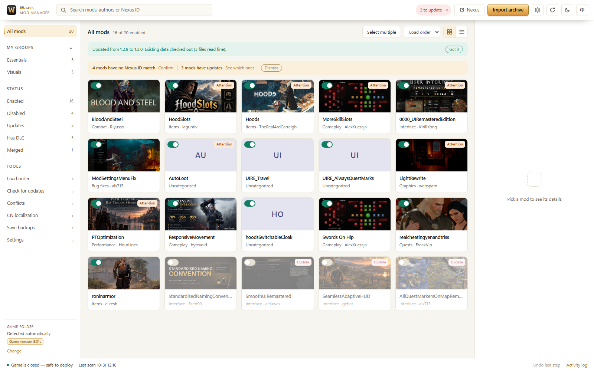
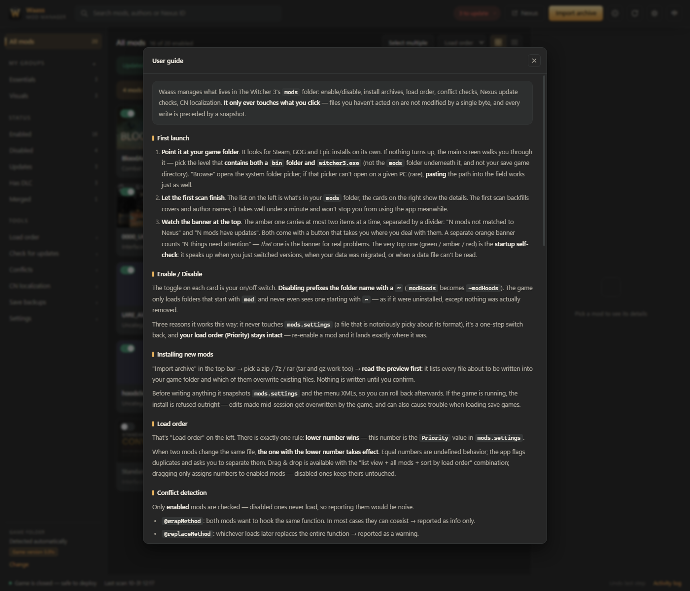

# Waass Mod Manager

A mod manager for **The Witcher 3: Wild Hunt — Remastered**. It is built with Chinese players in mind: developed in a Chinese-language environment, with a **mod localization** feature no comparable tool offers (language tables, scripts, and menu XML), while shipping a complete English interface for English-speaking players.

A single 9 MB executable. Double-click to run — no installation, no .NET, no other mod manager. Built on the Python standard library with plain HTML/CSS/JS, with zero third-party runtime dependencies.



## Design approach

In The Witcher 3, what actually decides which mod wins comes down to three things: the folder name under `mods`, the priority recorded in `mods.settings`, and whether scripts have been merged by Script Merger. Most tools treat these as a black box, leaving you to guess from the game log when something breaks.

Waass puts them in plain view: which mods are active, which one loads first, which function is rewritten by two mods at once, and which menu file is no longer in use.

Three principles apply throughout:

- **Show before changing.** Installing, uninstalling, reordering, and localizing all produce a review list first.
- **Every step is reversible.** Write operations go onto an undo stack, uninstalls go to a quarantine folder, and localization keeps the originals.
- **Never guess.** Uncertain Nexus IDs, incomparable version numbers, and text too long to fit are reported as they are, not decided for you.

## Features

**Mod management**

- Scans and identifies mods, DLC, menu files, and language files
- One-click enable/disable: disabling renames the folder with a `~`, leaving `mods.settings` untouched and load order intact
- Drag rows to reorder, or use the dedicated load-order panel
- Imports 8 archive formats including zip, 7z, and rar, with a write-path preview
- Uninstalls move files to a quarantine folder instead of deleting them
- Custom groups and tags, with `#tag` search
- Batch selection: toggle several mods at once and undo them together

**Nexus integration**

- Identifies each mod's Nexus ID and fills in author, cover image, summary, and latest version
- Side-by-side version comparison: local versus the Nexus main file
- When identification is uncertain, candidates are listed for you to confirm — a wrong binding breaks version checks for good, so nothing is bound automatically
- No API key and no login; only public information is read

**Localization**

- Handles three sources separately: language tables, menu XML, and text embedded in scripts
- One-click translation with an editable result table before anything is written
- Menu pages only by default; mod names and item names are left alone
- Writes back at identical length: oversized translations are shortened or reported, never truncated
- Original files are kept permanently, with per-batch or single-batch restore

**Conflicts and compatibility**

- Duplicate scripts, duplicate menu files, colliding interface files inside resource bundles, and functions annotated by several mods
- Recognizes Script Merger output so merged groups are not reported as conflicts again
- Checks legacy script encodings and outdated Chinese language tables
- Merges game-owned config files line by line, and removes only those lines on uninstall

**Safety**

- Scanning is strictly read-only
- The write gate denies everything by default, opening only `mods/`, `dlc/`, the menu config directory, and `mods.settings`
- Affected files are snapshotted before writing; writes are refused while `witcher3.exe` is running
- The local service binds to `127.0.0.1` only, uses a one-time token, validates the `Host` header, and rejects cross-site requests

## Requirements

| Item | Requirement |
| --- | --- |
| OS | Windows 10 / 11 (64-bit) |
| Game | The Witcher 3: Wild Hunt — Remastered v5.x (Steam, GOG, or Epic) |
| Browser engine | The bundled Microsoft Edge, or an installed Google Chrome |

The Witcher 3 has no Linux or macOS release, so this tool is Windows-only as well.

## Installation

### Download the executable (recommended)

1. Download `Waass-x.y.z.exe` from [Releases](https://github.com/AaronFley/Waass-Mod-Manager/releases)
2. Double-click to run; nothing is installed
3. If Windows reports an unknown publisher, that is expected for an unsigned executable — choose **More info → Run anyway**

Each release lists a SHA256 checksum you can verify.

Data lives in `data/` next to the executable, so copying that folder moves everything. If the executable sits in a location without write access, such as `Program Files`, data is stored in `%LOCALAPPDATA%\WaassModManager` instead.

### Run from source

```
git clone https://github.com/AaronFley/Waass-Mod-Manager.git
cd Waass-Mod-Manager
python run.py
```

Python 3.10 or newer, with no third-party packages and no `pip install`. You can also run `Waass.bat`.

```
python run.py              normal start
python run.py --browser    open in your default browser
python run.py --serve-only start the local service only (debugging)
python run.py --port 8765  use a specific port
```

## Getting started

1. **Select the game folder.** The app looks it up through Steam, GOG, and Epic records. If that fails, pick the folder that **contains `bin`**, not `bin` itself.
2. **Browse the mod list.** The first scan fills in covers and authors, usually within a minute. Scanning changes nothing on disk.
3. **Adjust load order.** Lower numbers load first, and the earlier mod wins a conflict.
4. **Install a mod.** Drop in an archive or use **Import archive**, then review the write paths before confirming.

A full guide is built in: **Settings → Guide**.



## Upgrading and your data

To upgrade, replace the executable. `data/` needs no attention: mod list, groups, Nexus records, install history, localization originals, and save backups all carry over.

Each start runs a self-check:

- Whether the version just changed, and whether existing data is readable
- Whether the data format needs migration; if so, a full backup is written to `data/_backup/pre-schema…/` first
- Corrupted data files are renamed to `xxx.json.broken-<timestamp>` and kept, and the app continues without them
- If the data was written by a newer version, the current version switches to read-only mode

Results appear in a bar at the top of the window: green for normal or freshly upgraded, yellow for attention, red for a data problem. **Settings → About** shows the data format version and offers a manual re-check.

## About localization

Interface text in a mod comes from three places, and they are handled differently:

| Source | Location | Handling |
| --- | --- | --- |
| Language table | `cn/zh.w3strings` | Translatable |
| Menu XML | `displayName` in `bin/config/…/pc/*.xml` | Translatable |
| Script literals | Language branches inside `.ws` files | Detected only |
| Already localized XML | Chinese literal values | Recognized as done, no longer counted |

Workflow: **Tools → Localization → select mods → Translate → review → Write**.

- Only menu pages are selected by default. Mod and item names may be referenced by scripts and saves, so they are opt-in.
- Translation uses a keyless public service by default; you can supply your own keys, which are rotated automatically.
- Writes are length-preserving, changing only text content while keeping file size and offsets intact. Translations that do not fit are shortened, and reported if still too long — never truncated.
- Originals are backed up to `data/localize/orig/` before writing, and can be restored at any time.

## FAQ

**Windows warns about an unknown publisher, or antivirus blocks the file?**
The executable is not code-signed, which is expected. Verify the SHA256 from the release page before allowing it.

**The game folder is not found.**
Select the folder containing both `bin` and `witcher3.exe`. If the game lives on an external drive or in a custom location, choose it manually — the path is remembered.

**The game is in `C:\Program Files (x86)` and installing mods fails on permissions.**
That location requires administrator rights. The app detects this at startup; run it as administrator.

**Does it conflict with a mod manager I used before?**
No. Nexus information left by another manager is read once, after which the app is fully independent, and removing the other manager changes nothing. There is no prerequisite for first-time users either.

**How do I move to another computer?**
Copy the executable and the `data/` folder beside it. The mod list and load order are read from the game folder at startup rather than stored as snapshots.

**Where is my data?**
Everything is in `data/`: configuration, Nexus records, groups, install history, snapshots, quarantine, and localization originals. Builds contain no user data.

**Does it connect to the internet?**
Only to fetch Nexus metadata and to check for program updates, both against public endpoints. No login, nothing uploaded, and both can be disabled in Settings.

## Disk usage

**Settings → Storage** groups usage into three tiers:

| Tier | Meaning | Includes |
| --- | --- | --- |
| Safe to delete | Rebuilt automatically | Window cache, stale files |
| Minor inconvenience | Features unaffected | Cover images, localization intermediates, snapshots |
| Permanent | Cannot be recovered | Quarantined mods, retained archives |

Core data — configuration, Nexus records, groups, install history, save backups — is never touched by cleanup.

Growth is also bounded automatically: the window cache is capped at 16 MB and cleared on exit, snapshots keep the latest 30, localization backups the latest 20, and the undo history holds 200 entries.

## Development

```bash
for f in tests/test_*.py; do python "$f"; done
```

Each test script creates its own temporary sandbox, so order does not matter and the real game folder is never touched. These are script-style checks; `unittest discover` will not collect them.

```bash
python tools/doctor.py snapshot   # record hashes of key game files
python tools/doctor.py check      # verify nothing was modified
python tools/coldstart.py         # run all read-only endpoints on empty data + a stub game folder
python tools/coldstart.py --no-game
```

Stack: Python standard library with plain HTML/CSS/JS — no framework, no build step.

### Program updates

The app checks this repository's GitHub releases by default, with no configuration required. **Check for updates** compares version numbers and links to the release page; it never downloads or replaces files on its own.

To use another source, override it in `data/config.json`:

```json
{"update_feed": "https://api.github.com/repos/user/repo/releases/latest"}
{"update_feed": "https://your-domain/waass/version.json"}
```

The custom JSON shape is `{"version": "1.3.0", "url": "download page", "notes": "what changed"}`. To disable the check entirely, use `{"update_check": false}`.

## Contributing

This is an **MIT-licensed open-source project**, and most of its code was built with AI. You are welcome to download, modify, and share it — and to localize it into other languages. Interface strings live in `web/i18n/zh.json` and `en.json`; adding one file adds a language, since the backend reads the same string table.

Please report significant bugs through [Issues](https://github.com/AaronFley/Waass-Mod-Manager/issues). I will keep improving the project.

## License

[MIT](LICENSE)
