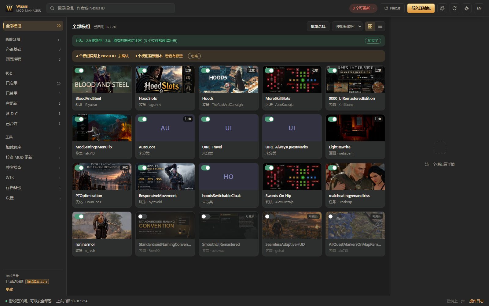
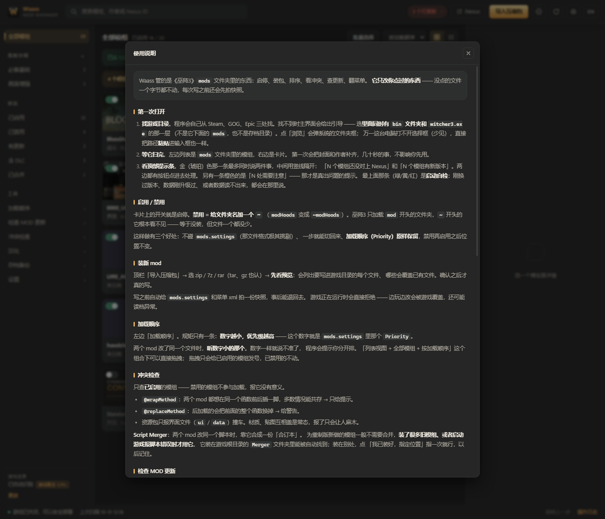

# Waass Mod Manager

《巫师 3：狂猎》重制版的模组管理器。**面向中文玩家**：在中文环境下开发，内置同类工具没有的**模组汉化**功能（语言表、脚本、菜单 XML 三条通道），同时提供完整英文界面，英文玩家同样可用。

9 MB 单文件，双击即用：不需要安装、不需要 .NET、不需要其他模组管理器。基于 Python 标准库与原生 HTML/CSS/JS，运行时零第三方依赖。



## 设计取向

巫师 3 里真正决定「谁生效」的是三件事：`mods` 下的文件夹名、`mods.settings` 里的优先级，以及脚本有没有被 Script Merger 合并过。多数工具把这三件事当作黑盒，出问题时只能对着日志猜。

Waass 把它们摊开来给你看：哪些模组在生效、谁排在谁前面、哪个函数被两个模组同时改写、哪个菜单文件其实已经失效。

三条原则贯穿全部功能：

- **改之前先给你看**：安装、卸载、排序、汉化都先出清单，确认后才写入。
- **每一步都能撤回**：写操作进入撤销栈，卸载进隔离区，汉化保留原件。
- **不猜**：认不准的 Nexus ID、比不出的版本号、放不下的译文，都如实标注，不替你做决定。

## 功能

**模组管理**

- 扫描并识别模组、DLC、菜单文件与语言文件
- 一键启用 / 禁用：禁用即给文件夹名加 `~`，不修改 `mods.settings`，加载顺序原样保留
- 列表拖拽调整加载顺序，也可在「加载顺序」面板集中修改
- zip / 7z / rar 等 8 种格式导入，先预览写入路径
- 卸载进隔离区，可随时恢复
- 自定义分组与标签，支持 `#标签` 搜索
- 批量选择：一次勾选多个模组同时开关

**Nexus 联动**

- 自动识别模组对应的 Nexus ID，补齐作者、封面、简介与最新版本
- 版本双栏对照：本地版本与 Nexus 主文件版本，可比较时直接给出结论
- 认不准时列出候选由你确认，绑定错误会让更新检查长期失效，因此不做自动绑定
- 无需 API Key、无需登录，只读取公开信息

**汉化**

- 三个文字来源分通道处理：语言表、菜单 XML、脚本内嵌文字
- 一键补翻：程序自动翻译，表格中可逐条修改，确认后一次写入
- 默认只翻译菜单页，模组名与物品名保持原样
- 写回保持文件长度不变，超长译文缩句或提示，绝不截断
- 原始文件永久保留，支持整批或单批还原

**冲突与兼容**

- 脚本同名、菜单重名、资源包内界面文件撞车、同一函数被多个模组注解
- 识别 Script Merger 的合并记录，已合并的组不再重复报错
- 旧版脚本编码与中文语言表版本检查
- 游戏自带配置按行合并，卸载时只撤销该模组写入的键

**安全**

- 扫描全程只读
- 写入闸门默认拒绝一切写入，仅对 `mods/`、`dlc/`、菜单配置目录与 `mods.settings` 放行
- 写入前快照受影响文件；检测到 `witcher3.exe` 运行中直接拒绝写入
- 服务仅监听 `127.0.0.1`，使用一次性令牌并校验 `Host` 头、拒绝跨站请求

## 系统要求

| 项目 | 要求 |
| --- | --- |
| 系统 | Windows 10 / 11（64 位） |
| 游戏 | 《巫师 3：狂猎》重制版 v5.x（Steam / GOG / Epic 均可） |
| 浏览器内核 | 系统自带 Microsoft Edge，或已安装的 Google Chrome |

《巫师 3》没有 Linux / macOS 版本，本程序同样只支持 Windows。

## 安装

### 下载 exe（推荐）

1. 在 [Releases](https://github.com/AaronFley/Waass-Mod-Manager/releases) 下载 `Waass-x.y.z.exe`
2. 双击运行，无需安装
3. 若 Windows 提示「未知发布者」，这是未签名程序的正常提示，选择「更多信息 → 仍要运行」

Release 页面附有 SHA256 校验值，可自行核对。

数据保存在 exe 同目录的 `data/` 中，整个文件夹拷走即可迁移。若 exe 位于 `Program Files` 等无写入权限的位置，数据自动改存 `%LOCALAPPDATA%\WaassModManager`。

### 从源码运行

```
git clone https://github.com/AaronFley/Waass-Mod-Manager.git
cd Waass-Mod-Manager
python run.py
```

需要 Python 3.10 或更高版本，无第三方依赖，无需 `pip install`。也可双击 `Waass.bat`。

```
python run.py              正常启动
python run.py --browser    用默认浏览器打开
python run.py --serve-only 仅启动本地服务（调试用）
python run.py --port 8765  指定端口
```

## 快速上手

1. **选择游戏目录**。程序会从 Steam、GOG、Epic 的记录中自动查找；找不到时请选择**包含 `bin` 文件夹**的那一层，而不是 `bin` 内部。
2. **浏览模组列表**。首次扫描会补齐封面与作者，通常几十秒；扫描本身不修改任何文件。
3. **调整加载顺序**。数字越小越先加载，冲突时先加载者生效。
4. **安装新模组**。拖入压缩包或从「导入压缩包」进入，确认预览中的写入路径后再执行。

程序内附完整说明书：**设置 → 使用说明**，讲的是判断依据而非按钮位置。



## 升级与数据

升级方式是把新版本 exe 覆盖旧文件，`data/` 不需要任何处理：模组列表、分组、Nexus 记录、安装档案、汉化原件与存档备份都会继续沿用。

每次启动会进行一次自检：

- 版本是否刚刚变化，原有数据是否可正常读取
- 数据格式是否需要迁移；需要时先整份备份到 `data/_backup/pre-schema…/`，再执行迁移
- 数据文件损坏时改名为 `xxx.json.broken-<时间>` 保留，程序跳过该文件继续运行
- 数据由更高版本程序写入时，当前版本进入只读模式，可查看不可写入

自检结果显示在界面顶部：绿色为正常或刚完成升级，黄色为需要注意，红色为数据异常。设置 → 关于中可查看数据格式版本，也可手动「重新自检」。

## 汉化功能说明

模组中的界面文字有三种来源，处理方式不同：

| 来源 | 位置 | 处理方式 |
| --- | --- | --- |
| 语言表 | `cn/zh.w3strings` | 可翻译 |
| 菜单 XML | `bin/config/…/pc/*.xml` 的 `displayName` | 可翻译 |
| 脚本内嵌 | `.ws` 中的语言分支 | 仅识别，不修改 |
| 已手工汉化的 XML | 中文字面值 | 识别为已汉化，不再计入待翻 |

使用流程：**工具 → 汉化 → 勾选模组 → 一键补翻 → 校对结果 → 写入**。

- 默认只勾选菜单页；模组名与物品名可能被脚本、存档引用，改动后难以归因，需要时再手动勾选。
- 译文默认使用免密钥公共接口，也可填入自己的密钥，程序会轮流使用。
- 写回为等长替换，只改动文本内容，文件大小与索引不变。放不下的译文会先缩句，仍超长时明确提示，不会截断。
- 写入前自动备份原件至 `data/localize/orig/`，随时可恢复到未汉化的状态。

## 常见问题

**提示「未知发布者」或杀毒软件拦截？**
程序未做代码签名，属于正常现象。可在 Release 页面核对 SHA256 后放行。

**找不到游戏目录？**
请选择包含 `bin` 与 `witcher3.exe` 的那一层目录。若游戏装在移动硬盘或非标准位置，可直接手动指定；路径会记入配置，下次无需重选。

**游戏装在 `C:\Program Files (x86)`，安装模组时报权限错误？**
该目录默认需要管理员权限。程序启动时会检测并提示，右键选择「以管理员身份运行」即可。

**会和以前用过的模组管理器冲突吗？**
不会。程序只读取其他管理器留下的 Nexus 信息一次，之后完全独立，删除其他管理器不影响使用。首次使用也没有前置条件。

**换电脑怎么办？**
把 exe 与旁边的 `data/` 一起拷过去即可。模组列表与加载顺序在启动时现场读取游戏目录，不会保存为快照。

**数据放在哪里？**
全部在 `data/` 中，包括配置、Nexus 记录、分组、安装档案、快照、隔离区与汉化原件。打包产物不包含任何用户数据。

**程序会联网吗？**
仅在补齐 Nexus 资料与检查程序更新时访问公开接口，不登录、不上传任何内容。两项功能均可在设置中关闭。

## 数据占用

设置 → **存储与清理** 按类别列出占用，分为三档：

| 档位 | 说明 | 包含 |
| --- | --- | --- |
| 可随时删除 | 删除后自动重建 | 窗口缓存、不再使用的旧文件 |
| 删除后略有不便 | 功能不受影响 | 封面图、汉化中间文件、快照 |
| 删除后无法找回 | 永久删除 | 隔离区中已卸载的模组、保留的安装包 |

核心数据（配置、Nexus 记录、分组、安装档案、存档备份）不参与任何清理。

程序也会自动控制增长：窗口缓存上限 16 MB 且退出时清理；快照保留最近 30 份；汉化备份保留最近 20 个；撤销记录上限 200 条。

## 开发

```bash
for f in tests/test_*.py; do python "$f"; done
```

每个测试脚本自行创建临时沙盒，执行顺序无关，不会触碰真实游戏目录。测试为脚本式自检，`unittest discover` 无法收集。

```bash
python tools/doctor.py snapshot   # 记录游戏目录关键文件哈希
python tools/doctor.py check      # 对比，确认程序未改动文件
python tools/coldstart.py         # 空数据目录 + 模拟游戏目录跑通只读接口
python tools/coldstart.py --no-game
```

技术选型：Python 标准库 + 原生 HTML/CSS/JS，不使用框架与构建工具。

### 程序更新检查

默认查询本仓库的 GitHub Release，无需配置。启动十秒后自动检查一次，有新版本时在顶部提示，点击即可打开 Release 页面。设置中的「检查程序更新」可随时手动确认，并显示该版本的更新说明。

检查结果缓存 24 小时，同一天内重复启动不会重复联网。程序只比对版本号并给出发布页链接，**不会自动下载或替换文件**。

如需更换更新源，在 `data/config.json` 中覆盖：

```json
{"update_feed": "https://api.github.com/repos/用户/仓库/releases/latest"}
{"update_feed": "https://你的域名/waass/version.json"}
```

自定义 JSON 格式为 `{"version": "1.3.0", "url": "下载页", "notes": "更新说明"}`。关闭检查可写 `{"update_check": false}`。

## 参与项目

这是一个 **MIT 开源项目**，绝大部分代码由 AI 构建。欢迎下载、修改、分享，也欢迎为它做其他语言的本地化 —— 界面文案位于 `web/i18n/zh.json` 与 `en.json`，新增一份即可支持一门新语言（后端读取同一份词表，无需改动代码）。

遇到重要问题请提交 [Issue](https://github.com/AaronFley/Waass-Mod-Manager/issues)，我会持续改进本项目。

## 许可

[MIT](LICENSE)
